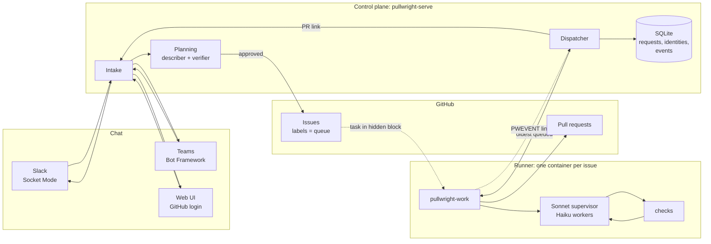

# Architecture

Pullwright has two halves. The **control plane** is one long-running process. It talks to chat, plans with read-only agents, opens issues and dispatches work. **Runners** are short-lived and isolated, one per issue. They clone, implement, test and open the pull request. The two share no database: a GitHub issue carries everything a runner needs.



## The request lifecycle (control plane)

A *request* is one task sent from chat. Requests are independent: a developer can send several, and they plan in parallel (up to `max_planning`, default 3).

```
mention ─► planning ─► awaiting_approval ─┬─► queued ─► pr_open | pr_draft | failed
                ▲                          │
                └──────── revise ──────────┤
                                           └─► cancelled
```

1. **Mention.** A channel turns a platform event into a `Mention` (`channels/base.py`): who, what, which thread, and the chat's default repository if one is mapped. Intake (`intake.py`) answers `help` and `link` directly.
2. **Identity.** The chat user must be linked to a GitHub account, so issues and PRs can tag them. If they aren't, the bot replies with a signed, expiring link. They open it and log in with GitHub, and `identities` records the binding. Web users are linked by logging in.
3. **Repository.** This is the first `owner/name` in the message, or the chat's default repository. If `PULLWRIGHT_REPOS` is set, other repositories are refused.
4. **Planning** (`pipeline/plan.py`) runs in a background thread on a cached, read-only clone that is refreshed before each plan.
   - The **describer** gets the request and a repository map, opens the files it needs, and returns a structured plan: `summary`, `relevant_files`, `plan` steps, `acceptance_criteria`, `test_plan`, `risks`, `questions`.
   - The **verifier**, an agent that did not write the plan, opens the files itself and returns `{approved, corrections, evidence}`. If it objects, the describer revises once with those corrections.
   - Both agents have only `read_file`, `glob` and `grep`. Nothing from the repository runs in the control plane.
5. **Approval.** The plan is posted as a card in the thread (Slack Block Kit, a Teams Adaptive Card, or the web plan card) with three actions:
   - **Revise** sends the developer's feedback back to the describer.
   - **Cancel** ends the request.
   - **Approve** counts only from a linked user with write access to the repository (checked live against GitHub).
6. **Issue** (`github/issues.py`). The approved plan becomes an issue that is assigned to the requester and labeled `pullwright` and `pullwright:queued`. Its body is written for people (who asked, who approved, the request, the plan with acceptance-criteria checkboxes). It ends with a hidden `<!-- pullwright:{...} -->` block holding the task and the structured plan. The issue link is posted in the thread.

## The issue lifecycle (queue and runner)

The queue is GitHub labels, so it is visible, editable and survives restarts:

| Label | Meaning |
|---|---|
| `pullwright:queued` | approved, waiting for a runner |
| `pullwright:working` | claimed by the dispatcher; a runner is on it |
| `pullwright:pr-open` | the PR is open and every check passed |
| `pullwright:failed` | the runner stopped red (draft PR or reason in a comment) |
| `pullwright:revising` | on a PR: a runner is addressing review feedback |

Pullwright PRs carry the `pullwright` label too, so the dispatcher can watch them for review feedback. A follow-up runs `pullwright-work --pr owner/repo#n` on the PR's branch with the plan, the earlier runs' work logs (bot comments on the PR) and the new comments as context. See [how a task flows](how-it-works.md#when-you-comment-on-the-pr-the-follow-up-loop).

**Dispatcher** (`dispatcher.py`). Every `PULLWRIGHT_POLL_SECONDS`, and while there is capacity (`PULLWRIGHT_MAX_PARALLEL`, default 1), it:
1. takes the **oldest** queued issue across the watched repositories;
2. labels it `working` before the runner starts, so it can't be claimed twice;
3. mints a GitHub installation token scoped to that one repository;
4. starts a runner.

It follows the runner's stdout to the end, stores its `PWEVENT` lines in the event log (so the web trace view can replay the run), and posts the result back to the thread the task came from. If a runner dies without reporting, the issue is labeled `failed` with a comment, never left `working`.

**Runner job** (`runner/job.py`, the `pullwright-work owner/repo#n` command):

1. Read the task back from the issue's hidden block, label it `working` and comment.
2. Clone with the short-lived token (the token is removed from the saved remote), and set the commit identity to `pullwright[bot]`.
3. Run the **work loop** (`pipeline/work.py`):
   ```
   setup (install dependencies)
   └─► round n:  Sonnet supervisor ─spawn_worker─► Haiku worker(s)   (fresh context per task)
                 └─► checks (build, lint, typecheck, test)            (commands, not a model)
                     ├─ any red  ─► failing excerpts become the next round's brief
                     └─ all green ─► independent reviewer (Sonnet) vs the acceptance criteria
                                     ├─ gaps     ─► gaps become the next round's brief
                                     └─ complete ─► done
   ```
   Every round is bounded by `PULLWRIGHT_MAX_ROUNDS` and the issue's dollar cap. The branch is `pullwright/<issue>-<slug>`.
4. Commit (even when red, so the draft shows how far it got), push, and open the PR (`github/prs.py`):
   - **Green:** a ready PR titled with the issue, body `Closes #n`, review requested from the requester. The body has what changed, a pass/fail line per check, the reviewer's verdict and the cost. The issue is labeled `pr-open`.
   - **Red or over budget:** a **draft** PR with the failing excerpts and why it stopped. The issue is labeled `failed`.

## Agents

| Role | Model (default) | Tools | Output | Where |
|---|---|---|---|---|
| describer | Sonnet 5.5, effort medium | read_file, glob, grep | structured plan | control plane |
| verifier | Sonnet 5.5, effort medium | read_file, glob, grep | `{approved, corrections, evidence}` | control plane |
| supervisor | Sonnet 5.5, effort medium | read-only + bash + `spawn_worker` | report | runner |
| worker | Haiku 5.5, effort medium | every tool (sandboxed) | report | runner |
| diagnosis (reviewer) | Sonnet 5.5 | read-only + bash | `{complete, gaps, evidence}` | runner |
| intake, summarizer | Sonnet 5.5 | | | [local mode](local-mode.md) |

Models and prompts are files: `server/pullwright/defaults/agents/<role>.md` (frontmatter: `model`, `effort`, `tools`, `max_turns`, `max_cost_usd`; body: the system prompt). A repository can override any role in its own `.pullwright/agents/`. See [configuration](configuration.md).

All agents run through one loop (`agent.py`):
- streaming with adaptive thinking;
- prompt caching on the system prompt and the conversation tail;
- structured output where a role needs it;
- strict tool schemas;
- the server-side refusal fallback on models that support it (Claude Haiku 5.5 doesn't, so its requests omit it).

`Session` (`session.py`) builds every agent the same way: the repository's config, the tool sandbox, guardrails, hooks, skills and budgets.

## Repository map and checks

- **Repo map** (`repomap.py`): the file tree with each source file's top-level symbols, built once per commit and given to the describer, verifier and supervisor, so agents don't spend turns rediscovering the layout.
- **Checks** (`checks.py`): `setup` plus named checks. They're detected from the project (uv/pip, npm/pnpm/yarn/bun scripts, `go`, `cargo`, Maven, Gradle) and overridden by `.pullwright/checks.json`. Every check runs every round. Failures are cut down to the failing lines plus the tail before they go back to the supervisor.

## Data

SQLite (`PULLWRIGHT_DB`), one file:

| Table | Holds |
|---|---|
| `requests` | one row per chat task: channel, repo, requester, thread address, state, plan, issue and PR links, planning cost |
| `identities` | chat user (channel + user id) → GitHub login |
| `thread_messages` | the bot's replies and plan cards for web threads |
| `events` | every agent event (turns, tool calls, usage and cost), for planning runs and, via `PWEVENT`, for runner jobs |
| `runs` | local-mode runs |

## HTTP surface (`pullwright-serve`)

| Path | Purpose |
|---|---|
| `/auth/github/login`, `/auth/github/callback`, `/auth/logout` | web login (GitHub OAuth, signed session cookie) |
| `/link?token=` | bind a Slack or Teams user to the GitHub account that logs in |
| `/api/me`, `/api/requests`, `/api/threads/{id}`, `/api/requests/{id}/decision`, `/api/queue` | the web chat and queue |
| `/api/teams/messages` | the Teams messaging endpoint (Bot Framework JWT verified) |
| `/api/runs/...` | local mode |
| `/` | the built web UI |

## Security boundaries

- **Control plane:** it holds the GitHub App key, the Anthropic key and the chat credentials. It never runs repository code; planning is read-only.
- **Runner:** see [runners](runners.md).
  - It's a throwaway container: non-root, with CPU, memory and PID limits, `no-new-privileges`, no host mounts, `--rm`, and a wall-clock timeout.
  - It holds a token for one repository that expires within an hour, plus the Anthropic key (moving behind a control-plane proxy is on the [roadmap](roadmap.md)).
  - Agents there can't `git push` or call `gh`, and the guardrails' deny list still applies.
- **Approval:** only a linked user with write access can approve. The PR is reviewed by a person before it merges.
- **Inbound:**
  - Slack uses Socket Mode and has no endpoint.
  - Teams requests are verified against the Bot Framework's keys, the app id and the service URL.
  - Web sessions and link tokens are HMAC-signed with `PULLWRIGHT_SECRET` and expire.
- **Prompt injection:** repository files and issue text reach the agents. The controls are the sandbox, the scoped token, read-only planning and human review of every PR. Review Pullwright PRs as you would any outside contribution.

## Code map

```
server/pullwright/
  intake.py            mentions -> requests -> planning -> approval -> issue; account linking
  channels/            base.py (Mention, Decision, PlanCard), slack.py, teams.py
  web.py               web channel, GitHub login, /api routes, Teams webhook
  serve.py             pullwright-serve: wires everything from the environment
  pipeline/plan.py     describer + verifier + review loop
  pipeline/work.py     the runner's implement-until-green loop
  github/              client.py (App/PAT auth, REST), issues.py (queue), prs.py
  dispatcher.py        queue -> runners, max_parallel at a time
  runners/             base.py (Job, follow), docker.py, local.py
  runner/job.py        pullwright-work: issue -> clone -> work -> push -> PR
  checks.py repomap.py session.py agent.py tools.py config.py models.py pricing.py store.py events.py git.py
  lifecycle.py api.py cli.py   local mode
runner/Dockerfile      the runner image
web/src/               Requests.tsx (team flow), App.tsx, Chat.tsx and Trace.tsx (local mode)
```
