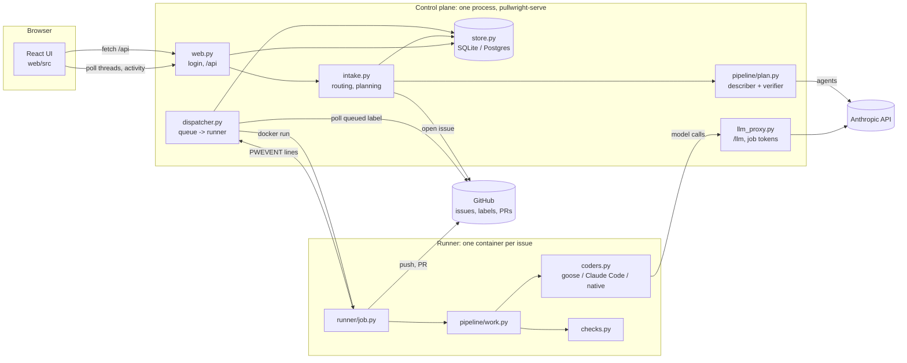
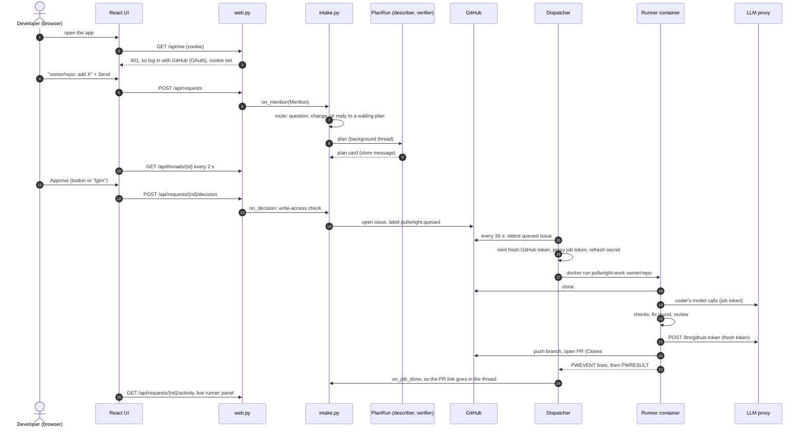

# Code walkthrough: from login to pull request

> A formatted version of this page: [code-walkthrough.html](code-walkthrough.html) (rebuild it with `uv run --no-project --with markdown python scripts/build_walkthrough_html.py`).

This follows one request through the code: logging in, sending a message, planning, approval, the queue, the runner, the coder, the checks, and the pull request. Paths are relative to the repository root; `server/pullwright/...` is the Python package, `web/src/...` the React UI. Line numbers are as of 2026-11-13.

## The pieces



What runs where:

- **Control plane** (`pullwright-serve`): one Python process with FastAPI, the planning agents, the dispatcher thread, the LLM proxy and the store. It reads `server/.env` when it starts (`server/pullwright/__init__.py:26`).
- **Runner**: a throwaway Docker container per issue, running `pullwright-work owner/repo#n`. It has the repository checkout, the toolchains, and Claude Code and goose.
- **GitHub** holds the queue: issues with labels. There is no message broker.

## The whole flow, in order



The rest of this page goes through each step.

---

## 1. Startup: `serve.build()`

`server/pullwright/serve.py:60` builds the app:

1. **GitHub client**: a GitHub App (`AppAuth`, installation tokens per repository) or a personal token for development (`github_from_env`, `serve.py:34`).
2. **Store**: `store.py:95`, SQLite at `server/pullwright.db`, or Postgres if `PULLWRIGHT_DB=postgresql://...`. Tables: `requests`, `thread_messages`, `events`, `identities`, `repo_profiles`, `runs`.
3. **Intake** (`intake.py:130`) with the allowed repositories, the planning budget, and a `LinkSigner` for Slack/Teams account linking.
4. **Organisation config**: `orgconfig.sync()` fetches the skills/rules repository (`PULLWRIGHT_ORG_CONFIG`) and pins its commit. It fails closed: no config, no start. A thread refreshes it every 5 minutes.
5. **Knowledge base**: profiles each allowed repository in the background, so a task that names no repository can be matched to one.
6. **Channels**: the web channel is always registered; Slack and Teams only if their tokens are set.
7. **`intake.recover()`**: plans left waiting by a previous process are closed, with a note in their thread.
8. **LLM proxy**: if `PULLWRIGHT_LLM_PROXY_URL` is set, a `Ledger` of job tokens plus the `/llm` routes (`llm_proxy.py:149`).
9. **Routers**: `/auth/...` at the root, the JSON API under `/api`, the built React app (`web/dist`) at `/`.
10. **Dispatcher thread** (`serve.py:~128`), with two callbacks:
    - `on_event` stores each runner event and lets intake move the request from queued to working;
    - `done` posts the result to the chat thread.

## 2. Login

**UI.** `web/src/App.tsx` calls `useMe()` (`web/src/Requests.tsx`), which does `GET /api/me`. A 401 shows `LoginScreen`, whose button goes to `/auth/github/login`.

**Server** (`web.py`):

- `login` (`web.py:99`): redirects to GitHub's OAuth page. The `state` parameter is signed (`Signer`, `web.py:36`, HMAC with `PULLWRIGHT_SECRET`) and expires in 10 minutes.
- `callback` (`web.py:107`): checks the state, exchanges the code for a token, reads the GitHub user, and sets the `pw_session` cookie: signed JSON `{login, name, exp}`, HttpOnly, valid 14 days. Nothing is stored server-side; the signature is the session.
- `me(request)` (`web.py:88`) is how every API route finds the user: it verifies the cookie or returns 401.
- **Account linking** for Slack/Teams users: `/link?token=...` (`web.py:127`) carries a token signed by `LinkSigner` (`intake.py:100`). After the GitHub login, `intake.complete_link` stores `channel user id -> GitHub login` in `identities`. That's how a Slack user's issues and PRs can tag their GitHub account.

## 3. Sending a message

**UI.**
- `Composer` (new thread) and `FollowUp` (an existing thread) in `web/src/Requests.tsx`. Both use `GrowingInput`: Enter sends, Shift+Enter adds a line.
- They call `team.create(repo, task, thread?)` in `web/src/api.ts`, which is `POST /api/requests`.

**Server.** `create` (`web.py:144`):
1. **Thread:** if a thread id is given, it must be the user's own thread, and its task must not be in `planning` (409).
2. **Store the message:** the user's message goes into `thread_messages` (the web channel keeps its own history).
3. **Hand it on:** it calls `intake.on_mention(Mention(user, text, {"thread": id}, url))`.

Slack (`channels/slack.py`) and Teams (`channels/teams.py`) build the same `Mention` from their own events. From here on, every channel is handled the same way.

## 4. Intake: routing a message (`intake.py`)

`on_mention` (`intake.py:187`) goes through these steps:

1. **Commands:** `link` and `help` are answered directly.
2. **Who:** `developer()` maps the chat user to a GitHub login. Without one, the user gets a link to connect their account.
3. **Which repository:** `split_repo()` (`intake.py:81`). A repository counts if it leads the message (`owner/name: ...`) or is a configured one; words like `long/short` are not repositories. Otherwise: the thread's repository, the channel's default, or the knowledge base's guess (it says what it picked and why). It must be in `PULLWRIGHT_REPOS`.
4. **Thread state:** `_thread_requests()` finds the thread's requests. A thread has at most one task in progress (`planning`, `awaiting_approval`, `queued`, `working`). While a plan is being drafted, new messages are held back.
5. **Intent.** `quick_intent()` (`intake.py:65`) handles the obvious cases without a model:
   - the first message starts with a change verb (`add`, `fix`, `build`, ...): **change**;
   - a plan is waiting and the reply is `approve`, `lgtm` or `cancel`, or starts with `revise: ...`: that decision.

   Anything else goes to the **responder** (`defaults/agents/responder.md`). It's a read-only agent that sees the repository map, the last 12 messages of the thread, the waiting plan and the fetched links, and returns `{intent, reply, task}` (`RESPOND_SCHEMA`):

   | Intent | What happens |
   |---|---|
   | `answer` | `_respond()` posts the reply; the request becomes `answered`, with its cost |
   | `change` | The responder's `task` (the conversation written up as one request) is planned |
   | `approve` / `revise` / `cancel` on a waiting plan | `_act_on_plan()` calls `on_decision()`, the same path as the buttons |
6. **Links** (`links.py`) are fetched before the responder or the describer runs. GitHub issues and PRs are read through the App; other pages are https only, public addresses only, at most 5.
7. **New request:** `store.create_request()` records it as `planning`, and the planning or answering runs on a thread pool (`max_planning`, default 3), so the HTTP call returns at once.

Every reply goes through `_reply()`. That posts it on the channel and also records it in `thread_messages` for Slack and Teams, so the responder has the conversation there too.

## 5. Planning (`pipeline/plan.py`)

`_plan()` (`intake.py:490`):

1. **Clone:** refresh a read-only clone of the repository (`_repo_clone`). No code from it is run; `Session(hooks=False)`.
2. **Session** (`session.py:32`): the planning budget (`PULLWRIGHT_PLAN_MAX_COST_USD`, default $1). Its event bus writes to the store (`store.append`), so the UI can show "describer is reading the repository".
3. **`PlanRun.run()`** (`plan.py:142`):
   - `describe()`: the describer (Sonnet, read-only tools `read_file`, `glob`, `grep`) writes the plan as JSON (`PLAN_SCHEMA`): title, a short summary, relevant files, steps, acceptance criteria, test plan, risks, questions;
   - `verify()`: the verifier checks the plan against the code (`VERIFY_SCHEMA`: approved, corrections, evidence). If it objects, the describer gets one more pass with the corrections;
   - `reviewer.review_plan()`: `_ChannelReviewer` (`intake.py:566`) posts the plan card (`channel.show_plan`), sets the request to `awaiting_approval`, and **blocks** that planning thread until a decision arrives in a queue (`_PendingReview`), or a week passes;
   - on **revise**, the loop runs again with the feedback (at most 3 revisions); on **cancel** it raises `PlanCancelled`.
4. **Approve:** `on_decision()` (`intake.py:248`) checks that the approver has write access (`gh.can_write`) before the decision is accepted. Then `issues.open_issue()` (`github/issues.py:99`) creates the issue:
   - a readable body: requester, approver, request and plan;
   - a hidden `<!-- pullwright:{...} -->` block with the task, the structured plan, the requester and the thread address. This is what the runner reads later;
   - labels `pullwright` and `pullwright:queued`.
5. **Costs and reply:** planning costs go into `requests.costs` (stage `plan`), and the thread gets the issue link.

Each agent call goes through `Session.run()`, then `agent.run_agent()` (`agent.py:41`), the tool loop:
- call the model, emit `usage` with tokens and cost (`pricing.py`);
- run each tool the model asked for (`tools.py`), emit `tool_call` and `tool_result`;
- repeat until the model stops, the turn limit is reached, or the dollar cap is spent.

`providers/` turns each call into an Anthropic or OpenAI-compatible request (or a proxy request in a runner).

## 6. The UI while this happens

- **`Thread`** (`web/src/Requests.tsx`) polls `GET /api/threads/{id}?after=n` every 2 seconds:
  - **messages**: user bubbles, bot replies (markdown), plan cards;
  - **request row**: state, issue, PR, cost.
- **`PlanCard`**:
  - shows title, summary (clamped), Steps, Files and Tests;
  - Verifier, Done when and Risks are folded;
  - the buttons call `POST /api/requests/{rid}/decision`.
- **`useActivity`** (`web/src/Timeline.tsx`) polls `GET /api/requests/{rid}/activity` (planning and runner events from `events`) every 2 seconds while the request is live:
  - `steps()` turns them into the lifecycle (Plan, Approve, Queue, Runner, Pull request);
  - `RunnerPanel` shows the run's state, check results, agents and recent tool calls.
- **Layout:** in landscape at 1024 px or wider, the lifecycle sits in a column on the right; otherwise above the chat.

### The PR in the chat, and the chat on the PR

Once a request has an open PR:

- **GitHub → chat:** a thread started by `serve.build` runs `intake.sync_github()` every `PULLWRIGHT_GITHUB_SYNC_SECONDS`. For each `pr_open` / `pr_draft` request it reads `feedback.conversation()` (comments, inline comments, reviews; no bots, no chat echoes), skips what `store.synced()` already has, and posts the rest. The web UI gets `github` messages, rendered as cards by `GitHubComment` in `web/src/Requests.tsx`; Slack and Teams get a short reply.
- **Chat → GitHub:** `on_mention` sends a message in a thread whose PR is open to `_converse_pr()`. The responder answers a question in the chat. A change is checked for write access, then posted with `gh.comment()` as `feedback.chat_comment()`: the developer's words, a signature, the folded reading and the hidden marker. The PR follow-up loop (section 8) picks it up like any review comment. The dispatcher passes the App's bot login so the collector trusts only that account's markers.

## 7. The dispatcher (`dispatcher.py`)

A thread runs `serve()` (`dispatcher.py:171`), which calls `tick()` every `PULLWRIGHT_POLL_SECONDS` (30):

1. **Capacity:** if fewer than `PULLWRIGHT_MAX_PARALLEL` jobs are running, `next_job()` picks one:
   - review feedback on an open Pullwright PR first (`feedback_job`);
   - otherwise the oldest `pullwright:queued` issue (`issue_job`, `issues.queued()`).
2. **Claim:** the issue is relabelled `pullwright:working` before the container starts, so the next poll can't pick it twice.
3. **The `Job`** (`runners/base.py`) is the repository, the issue number, and:
   - **a newly minted GitHub token** scoped to that one repository (`gh.auth.token(repo, fresh=True)`, valid one hour);
   - **environment** (`_env`): caps and model settings. With the LLM proxy it also gets the proxy URL, a **job token** with the dollar cap (`Ledger.issue`) and a **refresh secret**, instead of provider keys. It also gets the org config's pinned commit and a read-only token for it.
4. **Start:** `_run()` starts the container (`DockerRunner.start`, `runners/docker.py:66`):
   - `docker run --rm --init --user 1000:1000`, CPU, memory and PID limits, `no-new-privileges`;
   - the shared cache volume at `/home/runner/.cache`;
   - `timeout 90m pullwright-work owner/repo#n`;
   - secrets go in as `-e NAME`, so they never appear on a command line.
5. **Follow:** `follow()` (`runners/base.py:65`) reads the container's output:
   - `PWEVENT {...}` lines go to `on_event` (the store and the UI);
   - the final `PWRESULT {...}` line is the job's result;
   - everything else goes to the server log.
6. **Settle:** `_settle()` revokes the job token and keeps the proxy's spend record, which the runner can't alter. If the container ended without a result, the issue is labelled `pullwright:failed` with a comment. `on_done` then calls `intake.on_job_done()`, which records costs, sets `pr_open` / `pr_draft` / `failed`, and posts the PR link in the thread.

## 8. Inside the runner (`runner/job.py`)

`main()` (`job.py:192`):

1. Stdout becomes the event stream (`_stdout_sink`: each event is printed as a `PWEVENT` line).
2. In a temporary folder, `orgconfig.load_in_runner()` fetches the pinned org config commit into `<tmp>/org-config`. It sits next to the checkout, not inside it, so it is never committed.
3. **`run_job()`** (`job.py:87`):
   - `issues.parse()` reads the hidden block in the issue body: task, plan, requester. An issue Pullwright didn't write is refused;
   - comments "A Pullwright runner picked this up";
   - `git.clone()` with the token; the token is removed from the saved remote;
   - a `Session` with the job budget (`PULLWRIGHT_MAX_COST_USD`), approving "ask" commands automatically: the container is the sandbox;
   - **`WorkRun(...).run()`**, the workflow (next section), with the coder chosen for this repository (`coders.coder_for(repo)`);
   - **`refresh_github(gh)`** (`job.py:57`): asks the control plane for a fresh GitHub token (`POST /llm/github-token`, with the job token and the refresh secret), because the work may have outlasted the first token;
   - no commit: label `failed` and comment why. Otherwise:
     - `git.push()`;
     - `prs.open_pr()` (`github/prs.py:34`): the plan's title, a body with the checks and the cost table, `Closes #n`, a review request to the requester;
     - a work-log comment on the PR;
   - prints `PWRESULT {status, pr_url, cost_usd, costs, ...}`.
4. **`run_feedback()`** (`job.py:134`) is the same for review comments on an open PR: it checks out the PR branch and passes the comments and earlier work as context. The fix lands on the same branch.

## 9. The workflow: `WorkRun` (`pipeline/work.py`)

```
setup -> coder -> checks --fail--> coder (with the failures) -> checks --fail--> draft PR
                    | pass
                    v
                 review (diagnosis) --gaps--> coder (with the gaps) -> checks ...
                    | complete
                    v
                 commit -> green
```

`run()` (`work.py:167`):

1. **Branch:** `<issue>-<slug of the title>` (or the PR branch, for feedback).
2. **`setup()`** (`work.py:106`): runs `.pullwright/checks.json` → `setup` (for example `uv sync`). If it fails, the status is `setup_failed`.
3. **Each round**, up to `max_rounds` (**default 2**, as Stripe's Minions allow at most two CI runs):
   - **`supervise(feedback)`** (`work.py:122`): the agent step. The prompt (`_brief`) has the issue, the request, the approved plan, the check commands, any context, and the repository map. On the second round it also has `git diff --stat` and the failures to fix first;
   - **`run_checks()`**: `checks.py` runs each check command (`lint`, `build`, `test`, `typecheck`, from `checks.json` or detected from the project files). **Commands decide; no model judges this.** Failures are cut down to the useful lines (`failure_excerpt`);
   - all checks pass: **`diagnose()`**, Pullwright's own reviewer agent, compares the diff with the acceptance criteria (`DIAG_SCHEMA`). Complete means `green`; gaps go back to the coder as feedback.
4. **`_finish()`**: commits everything, green or not. A red result still becomes a draft PR that shows how far it got. It then emits the final state with the cost.

The session's budget is checked on every model call: over the cap, `BudgetExceeded` makes the status `budget`.

## 10. The coder (`coders.py`)

`supervise()` hands the agent step to the coder chosen for the repository (`PULLWRIGHT_CODER`, `PULLWRIGHT_CODER_BY_REPO`). **goose is the default** (`coders.DEFAULT_CODER`); see [coders](coders.md) for how the three compared.

**`native`.** A Sonnet supervisor (`defaults/agents/supervisor.md`) with a `spawn_worker` tool (`session.py:144`). Each worker is a Haiku agent with a fresh context and the file and bash tools. It does one piece of the plan and reports back. Specialists from the org config are available as `spawn_specialist`.

**`claude-code` / `goose`.** `_external()` (`work.py`) calls `ExternalCoder.run()` (`coders.py:272`):

1. **Its own `HOME`:**
   - the org's and repository's skills copied to `~/.claude/skills` and `~/.agents/skills`;
   - guard scripts in `~/bin`, first on `PATH`, that refuse `git push`, `gh`, `pkill` and `killall`.
2. **Environment** (`process_env`):
   - GitHub tokens and the refresh secret removed;
   - `ANTHROPIC_BASE_URL` / `ANTHROPIC_HOST` set to the **LLM proxy**, and `ANTHROPIC_API_KEY` to the job token, so every call counts against the job's cap;
   - the cache variables still point at the shared cache.
3. **Prompt:** the runner rules (`EXTERNAL_BRIEF`: tests first, run the checks before finishing, don't commit or push, stop processes by PID), then the org's and repo's instructions, then the brief.
4. **Command:**
   - Claude Code: `claude -p --output-format stream-json --verbose --model ... --max-turns ... --permission-mode bypassPermissions --disallowedTools ...`, with the prompt on stdin;
   - goose: `goose run --instructions <file> --no-session --no-profile --with-builtin developer --output-format stream-json --max-turns ...`.
5. **Output:** each JSON line goes through `ClaudeStream` or `GooseStream`, which turn it into Pullwright events (`agent_start`, `text`, `tool_call`, `tool_result`, `usage`, `agent_end`). They go on the session's bus, so they reach the store, the runner panel, and the budget check.
6. **Cost:**
   - Claude Code reports usage on each message;
   - goose reports totals at the end, so its cost is the proxy's count (`GET /llm/spend` before and after the step).

## 11. The LLM proxy (`llm_proxy.py`)

It runs inside the control plane and is reached from runners as `http://host.docker.internal:8765/llm`.

| Route | Purpose |
|---|---|
| `POST /llm/anthropic/v1/messages` | Swap the job token for the real key, forward the call (streamed or not), read the usage, charge the job. Over the cap: 402 |
| `POST /llm/anthropic/v1/messages/count_tokens` | Free; Claude Code calls it |
| `POST /llm/<provider>/chat/completions` | Any OpenAI-compatible provider |
| `GET /llm/spend` | The job's spend so far |
| `POST /llm/github-token` | A fresh GitHub token for the job's repository; needs the job token **and** the refresh secret, which agents never see |

The ledger is in memory. A control-plane restart cancels running jobs' tokens, and `intake.recover()` closes plans that were waiting.

## 12. What protects what

| Rule | Where |
|---|---|
| Planning can't change anything | Read-only tools; `Session(hooks=False)` on the control plane |
| A person with write access approves | `on_decision()` → `gh.can_write()` |
| Commands decide when the work is done | `checks.py`; the reviewer runs only after the checks pass |
| Agents can't push or open PRs | No GitHub credentials in agents' commands (`tools.agent_env`, `coders.SCRUB_ENV`); deny lists (`tools.DENY`, `work.RUNNER_DENY`); guard scripts for external coders; the pipeline pushes |
| Agents can't end their own job | `pkill`, `killall` and group kills are denied |
| Every job has a dollar cap | `Session.check_budget()` in the runner, and the proxy's 402 on the control plane |
| A runner sees only its repository | Installation token scoped to that repository; secrets passed as `-e NAME` |
| Org rules can't be dropped by a repository | `config.py` combines deny lists and hooks; agents and skills layer defaults < org < repo |

## 13. Where state lives

| What | Where |
|---|---|
| The queue | GitHub labels: `pullwright:queued` → `working` → `pr-open` / `failed`, `revising` on a PR |
| The plan, for the runner | The hidden block in the issue body |
| Requests, threads, events, costs | The store (`server/pullwright.db`) |
| Web sessions | The signed cookie |
| Waiting plans, job tokens | Control-plane memory (lost on restart) |
| Shared package caches | The `pullwright-cache` Docker volume |

## 14. Where to start reading

- One function per stage: `web.create` → `Intake.on_mention` → `Intake._plan` → `PlanRun.run` → `issues.open_issue` → `Dispatcher.tick` → `runner.job.run_job` → `WorkRun.run` → `coders.ExternalCoder.run` / `Session.run` → `prs.open_pr` → `Intake.on_job_done`.
- The tests read like a script of the same flow. `tests/test_intake.py::test_chat_then_confirm_plans_answers_about_the_plan_and_approves_by_text`, `tests/test_runner.py` and `tests/test_coders.py` exercise each stage with fakes for GitHub and the model.
