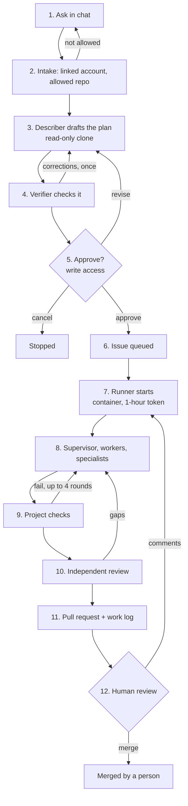

# How a task flows through Pullwright

This walks one task from the moment someone types it to the moment the PR is open. It covers what runs where, when a model is called, how both kinds of GitHub authentication work, and what you actually have to run. The numbers come from the first live runs on `arcanetech-ai/pullwright-sandbox`.

## The run at a glance



## What you run

| | What | Lifetime |
|---|---|---|
| **1** | `pullwright-serve`: one Python process holding the web UI and API, the Slack connection, the Teams webhook, the planning agents, the dispatcher and an SQLite file | always on |
| **2** | A Docker daemon on the same machine | always on |
| per task | One runner container (`pullwright-runner` image) | about 1–10 minutes, removed when done |

Outside services it calls: the **GitHub API**, the **Anthropic API**, and **Slack** and/or **Teams** if you use them.

There is no Redis, no message broker and no database server. The queue lives on GitHub (issue labels), and state lives in one SQLite file. That is enough for one organization. For more scale, you would add EC2 runners and Postgres (see the [roadmap](roadmap.md)).

## Questions, changes and conversation

Every message is routed before anything is planned (`intake.py`):

- **A question** goes to the **responder** (`defaults/agents/responder.md`, Sonnet, read-only tools). It answers in the thread with short sections and bullets, naming the files it read. The request is recorded as `answered` with its cost.
- **A change** goes to planning. A first message that starts with a change verb skips the responder. Later messages go through it, and it writes the conversation up as one complete task.
- **A message while a plan waits** is read as approve, revise, cancel or a question about the plan. Typed approvals go through the same write-access check as the button. *approve / lgtm / cancel / revise: ...* are decided without a model call.
- A thread has at most one task in progress. While its plan is being drafted, new messages are held back; while the runner works, the responder only answers.

**Links are read before any agent starts** (`links.py`), the way Stripe's Minions pre-run tools over a request's links. GitHub issue and pull request links go through the GitHub client, so private ones work. Other links are fetched only over https, only from public addresses (including after every redirect), with a 10-second timeout, 1 MB size limit and at most 5 links. Their text goes to the responder and the describer. A link that can't be read is listed with the reason.

The responder sees the last 12 messages of the thread (the web UI stores them; for Slack and Teams intake keeps them in the same table), and the waiting plan when there is one.

## The timeline of one task

```
 t=0s    you: "arcanetech-ai/portfolio: add a dark/light theme toggle"        (web, Slack or Teams)
 t=0s    control plane: request created, "On it" posted in your thread
 t=1s    control plane: refresh a read-only clone of the repo, build the repo map
 t=2-25s describer (Sonnet) reads files and writes the plan; verifier (Sonnet) checks it    ~$0.07-0.09
 t=25s   plan card in your thread                                            waits for you
 t=?     you click Approve -> GitHub write-access check -> issue #N opened, labeled queued
 t+0-30s dispatcher sees the queued issue, labels it working, mints a repo-scoped token,
         starts a container
 t+15s   container: clone, `npm ci` / `uv sync`
 t+20s   supervisor (Sonnet) splits the plan, spawns Haiku workers that edit and run commands
 t+50s   checks (build, typecheck, lint, test): commands, no model
 t+55s   red -> failures go back to the supervisor, next round; green -> reviewer (Sonnet)
 t+70s   push branch, open PR "Closes #N", request your review, label pr-open
 t+70s   the PR link appears in your thread                                  ~$0.04-0.05
```

## Where the LLM is called

Every model call goes through one function, `run_agent()` in `server/pullwright/agent.py`. It calls the Anthropic Messages API with the official Python SDK:

```python
client.beta.messages.stream(
    model=agent.model,                         # claude-sonnet-5-5 or claude-haiku-5-5
    system=[{..., "cache_control": ephemeral}],  # the role's prompt, cached
    cache_control=ephemeral,                   # also cache the growing conversation
    messages=messages,                         # the conversation so far (append-only)
    tools=schemas(agent.tools),                # read_file, edit_file, bash, spawn_worker, ...
    thinking={"type": "adaptive", "display": "summarized"},
    output_config={"effort": ..., "format": <json schema>},  # structured output for planner, verifier, reviewer
    betas=[...], fallbacks="default",           # refusal fallback (not sent to Haiku, which has none)
)
```

It loops: stream a response → if the model asked for tools, run them (sandboxed to the repository) → send back the results → repeat until the model finishes, runs out of turns, or hits its dollar cap. Each response emits a `usage` event with tokens and dollars, and those events are the cost figures you see everywhere.

Which agent runs where:

| Agent | Model | Runs in | Can do | Called from |
|---|---|---|---|---|
| describer | Sonnet 5.5 | control plane | read files only | `pipeline/plan.py` `PlanRun.describe` |
| verifier | Sonnet 5.5 | control plane | read files only | `PlanRun.verify` |
| supervisor | Sonnet 5.5 | runner container | read, run commands, `spawn_worker` | `pipeline/work.py` `WorkRun.supervise` |
| worker | Haiku 5.5 | runner container | read, write, edit, run commands | the supervisor's `spawn_worker` tool (`session.py`) |
| reviewer (diagnosis) | Sonnet 5.5 | runner container | read, run commands | `WorkRun.diagnose` |

The planning agents run in the control plane with the key from `server/.env`. The runner agents run inside the container. The dispatcher passes the key to it by environment-variable name, so it never appears on a command line. A [roadmap](roadmap.md) item moves it behind a proxy so it never enters a runner at all.

The checks (`npm test`, `pytest`, `ruff`, `tsc`) are **not** model calls. Whether a task is done is decided by their exit codes.

## The two kinds of GitHub authentication

There are two separate mechanisms with different jobs.

### 1. GitHub OAuth app: who is this person? (web login)

It's used only to learn a developer's GitHub login.

```
browser -> /auth/github/login
   server builds a signed, 10-minute `state` and redirects to
   github.com/login/oauth/authorize?client_id=...&redirect_uri=.../auth/github/callback&scope=read:user&state=...
browser -> GitHub: you approve "Pullwright wants to know your username"
GitHub -> /auth/github/callback?code=...&state=...
   server checks the state's signature and expiry
   server POSTs code + client secret to github.com/login/oauth/access_token -> a user token
   server GETs api.github.com/user with it -> {"login": "Mystery01092000", "name": ...}
   server sets cookie pw_session = HMAC-signed {login, name, expiry 14 days}; the user token is discarded
```

From then on, every `/api/...` request carries that cookie, and the server checks its signature with `PULLWRIGHT_SECRET`. There are no server-side sessions, and Pullwright never keeps your GitHub user token.

**Slack and Teams users** link once. When the bot doesn't know them, it replies with `/link?token=...`, a token signed with the same secret that holds their chat id and expires in an hour. Opening the link runs the same OAuth login, and the callback stores *chat id → GitHub login* in the `identities` table.

### 2. GitHub App: act on repositories

It's used for everything that touches a repository: clone, issues, labels, comments, push, PRs.

```
server signs a JWT with the app's private key (.pem): {iss: APP_ID, exp: +9 min}, RS256
  GET  /repos/{owner}/{repo}/installation            (Authorization: Bearer <JWT>) -> installation id
  POST /app/installations/{id}/access_tokens  {"repositories": ["portfolio"]}  -> token, expires in 1 hour
every API call and git operation for that repo uses this token
```

The token works for **one repository** and dies within the hour. Pullwright caches it until five minutes before expiry. This token is what the dispatcher hands a runner. Issues, comments and PRs are authored by `pullwright-arcanetechai[bot]`, and commits by `pullwright[bot]`.

## How an issue is raised

When you click **Approve** (`intake.py` `on_decision`):

1. **Permission:** `GET /repos/{repo}/collaborators/{you}/permission` must return write, maintain or admin. Otherwise the approval is refused.
2. **Labels:** `pullwright`, `pullwright:queued`, `:working`, `:pr-open` and `:failed` are created if missing. A 422 "already exists" response is expected.
3. **Issue:** `POST /repos/{repo}/issues`, assigned to you, labeled `pullwright` and `pullwright:queued` (`github/issues.py` `open_issue`).
   - The title is the describer's short title.
   - The body has who asked and approved, the request, and the plan with acceptance-criteria checkboxes.
   - The body ends with a hidden HTML comment, `<!-- pullwright:{"task": ..., "spec": {...the whole plan...}, "requester": ...} -->`. That block is how the runner gets the task: no database is shared between the control plane and runners.
4. **Back to you:** the issue link is posted in your thread, and the request's state becomes `queued`.

## How the agent picks it up and works on it

**Dispatcher** (`dispatcher.py`, a thread inside `pullwright-serve`):

1. Every 30 seconds it asks GitHub for open issues labeled `pullwright:queued` in each repository in `PULLWRIGHT_REPOS`, oldest first.
2. If fewer than `PULLWRIGHT_MAX_PARALLEL` jobs are running (default 1), it takes the oldest one. It relabels it `pullwright:working` *before* starting anything, so it can't be picked twice, and mints that repository's installation token.
3. It runs the container:
   ```
   docker run --rm --user 1000:1000 --cpus 2 --memory 6g --pids-limit 2048 --security-opt no-new-privileges \
     -e PULLWRIGHT_GITHUB_TOKEN -e ANTHROPIC_API_KEY ... pullwright-runner timeout 90m pullwright-work arcanetech-ai/portfolio#5
   ```
4. It reads the container's stdout line by line. Each `PWEVENT {...}` line goes into the event log (so the trace shows in the web UI), and the request flips to `working`. The final `PWRESULT {...}` line is the outcome.

**Inside the container** (`runner/job.py`, then `pipeline/work.py`):

1. Read issue #5 and parse the hidden block back into the task and plan. Comment "A Pullwright runner picked this up."
2. Clone with the token, then remove the token from the saved remote. Set the commit author to `pullwright[bot]`, and create the branch `pullwright/5-<title-slug>`.
3. Run setup (`npm ci` here; `uv sync` for Python). If it fails, stop: the issue is labeled `failed` with the reason.
4. Run up to `PULLWRIGHT_MAX_ROUNDS` (default 4) rounds:
   1. **The supervisor** gets the request, the approved plan, the list of checks and the repository map. It splits the work and calls `spawn_worker(task, context)` for each piece.
   2. **Each worker** is a fresh Haiku agent that sees only its brief. It reads files, edits them and runs the command it was given, then reports back.
   3. **The supervisor** reads the diff and reruns commands to verify each worker, sending corrections when needed.
   4. **The checks run.** If any fail, their failing lines go back to the supervisor as the next round's brief.
   5. **If they all pass, the reviewer** (a separate Sonnet agent that saw none of the conversations) compares the diff with the acceptance criteria. Gaps go back to the supervisor; no gaps means done.
   6. **The dollar cap** (`PULLWRIGHT_MAX_COST_USD`, default $5) is checked before every model call.
5. Commit, push, then `POST /repos/{repo}/pulls`:
   - **Green:** a ready PR with `Closes #5` and a review request to you. The issue is labeled `pr-open`.
   - **Red or over budget:** a draft PR showing the failures. The issue is labeled `failed`.
6. Print `PWRESULT`. The dispatcher posts the PR link in your original thread, and the container is removed.

Agents in the container can't `git push` or run `gh`: those commands are denied in their tool sandbox, and only the pipeline itself pushes.

## When you comment on the PR: the follow-up loop

A PR is rarely perfect the first time. Review it as you would a colleague's: leave inline comments on lines, submit a review, or write in the conversation. Pullwright works through the comments **on the same branch, continuing from what it already did**.

```
 you comment on PR #12 (inline, a review, or the conversation)
   │  dispatcher, every 30 s: open PRs labeled `pullwright` -> new feedback from people with write access?
   │  ...waits until no new comment has arrived for 2 minutes (so you can finish reviewing)
   ├─ PR labeled pullwright:revising; container: pullwright-work --pr owner/repo#12
   │     clone the PR's branch
   │     context = the approved plan (from the issue)
   │             + every earlier run's work log (what was done, checks, reviewer verdicts, comments handled)
   │             + your new comments (inline ones with file, line and the diff hunk)
   │     supervisor + workers address the comments -> checks -> reviewer checks the comments are addressed too
   ├─ push to the same branch (the PR updates), reply "Addressed in <sha>" on each inline comment
   ├─ new work-log comment on the PR; label back to pr-open (or failed)
   └─ "Updated PR #12 after review: 3 comments addressed, all checks pass" in your original thread
```

**What is saved, and where.** The context a follow-up needs lives on GitHub, next to the code:
- **The plan:** the approved plan stays in the issue's hidden block.
- **The work so far:** this is the branch's commits.
- **What happened:** after every run the bot posts a **work-log comment** on the PR. It's readable (status, rounds, checks, reviewer verdict, comments addressed, the supervisor's report) and ends with a hidden `<!-- pullwright-log:{...} -->` block for the next run. It records `handled_until` and the ids of the comments it handled, so the next run neither misses a comment nor repeats one.

The SQLite event log keeps the full trace of every agent call for the web UI, but runners don't need it. That's how a follow-up on another machine (or a later EC2 runner) still has the whole story.

**Which comments count.**
- **Who:** only people with **write access** to the repository count. Bots, Pullwright itself and read-only users are ignored, so a stranger's comment on a public repository can't steer the agents.
- **What:** inline review comments, review summaries with text (an approval with no text is not a request), and conversation comments.
- **Skipping one:** start a comment with `@pullwright ignore` to discuss without triggering a run.
- **Mention-only mode:** with `PULLWRIGHT_FEEDBACK_TRIGGER=mention`, only comments that mention `@pullwright` count.
- **Debounce:** `PULLWRIGHT_FEEDBACK_QUIET_SECONDS` (default 120) sets how long to wait after the newest comment.
- **Priority:** follow-ups are served before new issues, because finishing work in progress comes first. They share the same `PULLWRIGHT_MAX_PARALLEL` limit.

Code: `dispatcher.py` (`feedback_job`), `github/feedback.py` (`collect`, `brief`), `worklog.py`, `runner/job.py` (`run_feedback`), and `pipeline/work.py` (`WorkRun(branch=..., context=...)`).

## Choosing the repository: the knowledge base

You don't have to name the repository. "Add a dark mode toggle to my portfolio" or "fix rounding in order totals" is enough when Pullwright works on several repositories.

For each repository in `PULLWRIGHT_REPOS`, Pullwright builds a **profile** from the GitHub API, with no clone: the description, topics, languages, README and every file path. It's stored in SQLite and rebuilt after 24 hours (`knowledge.py`). A task without `owner/name:` is resolved like this:

1. **Named.** If the repository's own name appears in the task ("…my **portfolio**"), that decides it.
2. **Keywords.** Otherwise each word of the task scores in the profile fields it appears in.
   - Fields are weighted: the name 5, topics and description 3, file paths 1.5, the README 1.
   - Words are weighted by **rarity** across your repositories: a word every repository has says nothing.
   - Code identifiers are split, so `OrderStore` matches `orders.py`.
   - Verbs such as *add*, *fix* and *remove* are ignored.
3. **Your history.** Repositories you've sent tasks for before get a small boost. History breaks ties between repositories that fit; **it never picks a repository on its own**.
4. **Decision.**
   - A clear winner is picked.
   - A close call goes to **one Claude Haiku call** over the top three profiles. It has no tools, costs a fraction of a cent, and an answer outside the candidates is ignored.
   - If nothing fits, the bot asks you, listing the likely repositories first.

The bot always says what it chose and why, e.g. *"Picked `arcanetech-ai/portfolio` (the task names it). To use another repository, start the task with `owner/name:`."* A wrong guess is caught at the plan card, before anything is built. In the web UI the repository field is optional, with a picker of your repositories.

## Skills, hooks and evals in this flow

All three are configured per repository in `.pullwright/` (see [configuration](configuration.md)) and apply to every pipeline. The difference is *when* they act.

**Skills: knowledge agents load when they need it.**
- **What:** `.pullwright/skills/<name>/SKILL.md` holds a description plus instructions, for example "how we write database migrations here" or "how to add a feature flag".
- **How it works:** every agent's system prompt lists each skill's one-line description. When the work touches that area, the agent calls the `load_skill(name)` tool and reads the full instructions. This is the same idea as Claude Code skills: the prompt stays small, and the detail is loaded only when relevant.
- **Where it applies:** the planning agents (describer, verifier) in the control plane, and the supervisor, workers and reviewer in the runner. Skills are read from the clone of the repository, so they apply to that repository only.
- **Code:** `config.py` (`Skill`, `system_prompt`) and `session.py` (`_load_skill_tool`, added to every agent when skills exist).

**Hooks: your own commands around the agents.**
- **What:** `.pullwright/hooks.json` lists shell commands that receive the event as JSON on stdin.
- **`pre_tool`:** runs before a tool call (e.g. `match: "write_file|edit_file"`). A non-zero exit **blocks** the call, and its stderr is returned to the agent as the reason. Use it to protect generated files or migrations, or to enforce "never touch `infra/`".
- **`post_tool`:** runs after a tool call, fire-and-forget. Use it for audit logs.
- **`state`:** runs on every pipeline state, such as `describing`, `verifying`, `awaiting_approval`, `setup`, `working`, `checking`, `reviewing`, `green` and `failed`. Use it to notify a channel, record metrics or start something external.
- **Where it applies:** `pre_tool` and `post_tool` apply to every agent everywhere. `state` hooks fire in planning (control plane), in runner jobs and follow-ups, and in local mode. Hooks run inside the environment the agent is in: on the runner they run in the container.
- **Code:** `config.py` (`run_hooks`) and `session.py` (`ctx()` wires `pre_tool` and `post_tool`; `_state_hooks` handles `state`).

**Evals: measuring changes before you trust them.**
- **What:** evals are not part of a live task. They are how you check that a change to a prompt, a model or the pipeline makes Pullwright better rather than just different.
- **How it works:** `cd server && uv run python -m evals.run` runs real tasks on throwaway repositories with real models. It grades each one with commands and reports pass/fail, cost and time per case.
- **`--pipeline team` (default):** measures what an approved issue goes through. That's the describer and verifier plan (auto-approved), then the runner loop with the case's checks as the project checks, then the reviewer. Plan cost and work cost are reported separately.
- **`--pipeline local`:** measures the local-mode lifecycle.
- **When to run them:** run them before changing anything in `server/pullwright/defaults/agents/` or `models.py`, and put the before/after numbers in the PR ([CONTRIBUTING](../CONTRIBUTING.md)). They spend real money, so cap them with `--max-cost`. They aren't in CI for that reason; a nightly workflow is on the [roadmap](roadmap.md).
- **Code:** `server/evals/run.py`; cases are in `server/evals/cases/*.json`.

## Where to look when something goes wrong

| Symptom | Look at |
|---|---|
| no plan appears | server log (planning errors are also posted in the thread) |
| issue not picked up | is the repo in `PULLWRIGHT_REPOS`? does it have the `pullwright:queued` label? server log lines with `dispatcher` |
| runner failed | the comment the runner left on the issue; server log lines prefixed with `[owner/repo#n]` |
| a check fails in the runner but not locally | the runner image lacks a tool your project needs; see [runners](runners.md) |
| cost | the plan card, issue body, PR body and the web Queue view show it; the `events` table has every call |
| a PR comment was not picked up | did the commenter have write access? is the PR labeled `pullwright`? was it within the quiet period? did it start with `@pullwright ignore`? the work-log comments show what the last run handled |
| the wrong repository was picked | the bot's "Picked ... because ..." reply shows why; start the task with `owner/name:`, or improve the repository's description and topics on GitHub, which feed its profile |
