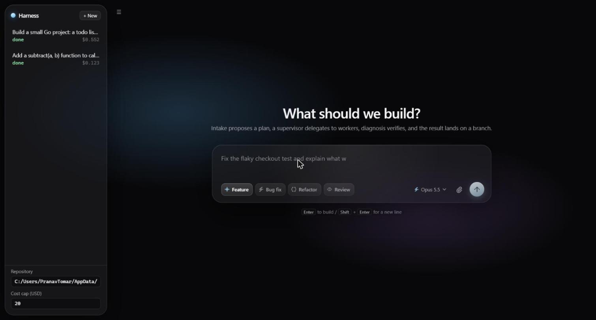
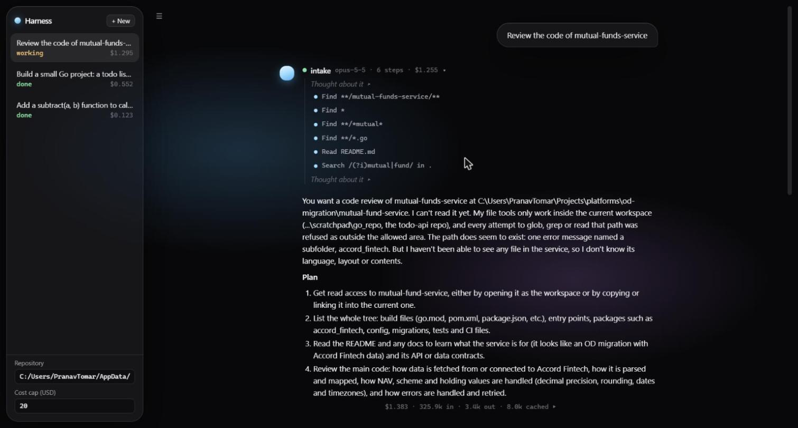
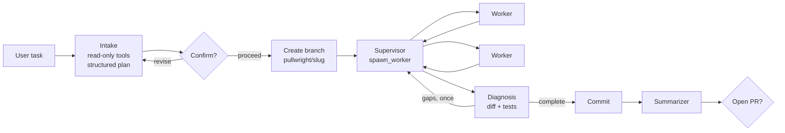
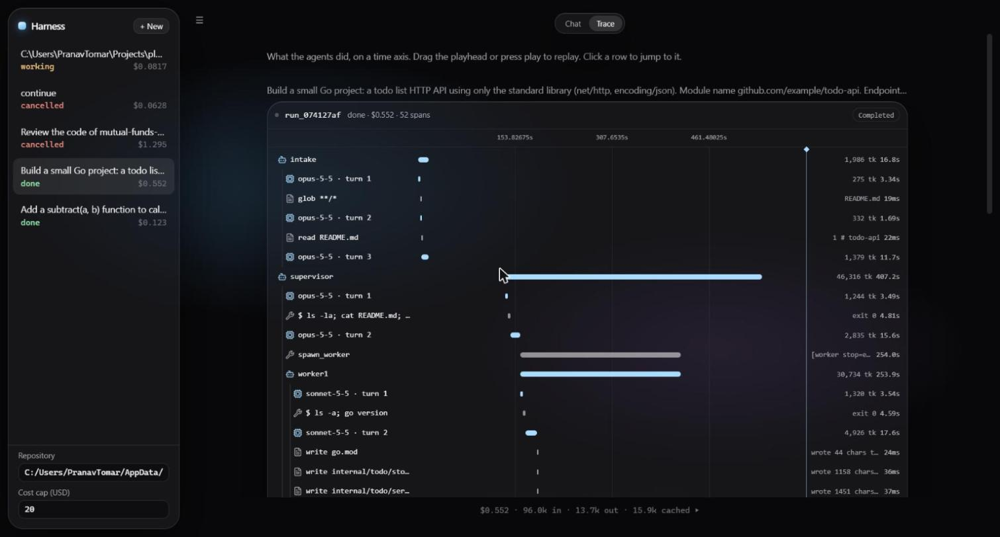

# Local mode

Pullwright grew out of *agent-loom*, a single-developer harness: you point it at a folder on your machine, describe a task, and it plans, works on a branch, verifies and offers a PR. That flow is still here, under **Local runs** in the web UI and in the terminal. It shares the agent core (loop, tools, guardrails, budgets, MCP, skills, hooks, event log and trace view) with the team flow.



## The idea: work the way a careful developer does

1. **Understand the problem before touching anything.**
   - An *intake* agent (read-only) restates the request, drafts a numbered plan and lists open questions.
   - You confirm or correct it in the chat before anything else happens.
2. **Break the work into small, independent tasks.** A *supervisor* owns the confirmed plan and delegates each piece to a *worker* with fresh context and a precise brief. Workers are cheaper models with a narrower job. The supervisor doesn't edit files.
3. **Review the changes; don't trust the report.**
   - The supervisor rereads each worker's output and sends corrections when needed.
   - A separate *diagnosis* agent, which never saw the workers' conversations, gets the request, the plan and the git diff, runs the tests itself, and decides whether the request is satisfied. Gaps get one more bounded pass.
4. **Summarize and raise the PR.** The work lands on a `pullwright/<slug>` branch with a summary written for people. You decide whether a PR is opened.



## Lifecycle



Run states: `intake → awaiting_confirmation → working → diagnosing → summarizing → awaiting_pr_decision → done`, plus `failed` and `cancelled`.

**Continuing a chat.** Typing under a finished, failed or cancelled run starts a follow-up run on the same branch. Intake gets the thread's history (each earlier request, its verdict and summary), so "continue where you stopped" or "also add X" works as it would with a colleague.

## Running it

```bash
cd server && uv sync
echo "ANTHROPIC_API_KEY=sk-ant-..." > .env
uv run uvicorn pullwright.api:app --port 8765      # API for local mode only
cd ../web && npm ci && npm run dev                 # http://localhost:5173 -> Local runs
```

Or use `uv run pullwright-serve`, which serves local mode next to the team flow.

### Terminal

```bash
uv run pullwright --cwd /path/to/repo                                   # interactive session
uv run pullwright "add a hello() function with a test" --cwd /path/to/repo --once
uv run pullwright "task" --cwd /path/to/repo --worker-model claude-haiku-5-5
uv run pullwright "task" --cwd /path/to/repo --worker                   # one worker, no lifecycle
```

At the prompt:
- `/new` starts a new thread;
- `/cost` shows the session's spend;
- `/help` and `/quit` do what they say;
- `Ctrl+C` cancels a run and keeps the session open.

### MCP servers

Put a `server/mcp.json` next to the server (the same shape as Claude Desktop's):

```json
{ "mcpServers": { "fs": { "command": "npx", "args": ["-y", "@modelcontextprotocol/server-filesystem", "/data"] } } }
```

The tools appear as `mcp__<server>__<tool>` and can be allowlisted per agent.

## Trace view

Every thread has a Chat / Trace switch. Trace puts each run on a time axis built from the event log: agents are parent spans, and every model turn and tool call is a child span with its real duration, tokens, cost and the first line of its output. Drag the playhead to replay what the agents did and when, including parallel workers.



## Local-mode API

| Method | Path | Purpose |
|---|---|---|
| POST | `/runs` | start a run: `{task, cwd, main_model?, worker_model?, max_cost_usd?, continue_from?}` |
| GET | `/runs` | list runs |
| GET | `/runs/{id}` | the run plus any pending decision |
| POST | `/runs/{id}/decide` | answer a pending decision: `{approved, feedback?}` |
| POST | `/runs/{id}/cancel` | stop a run |
| GET | `/runs/{id}/events?after=&types=` | replay the event log |
| GET | `/runs/{id}/stream` | SSE: replay, then live |
| GET | `/runs/{id}/cost` | token and dollar rollup per agent and per model |

Under `pullwright-serve` these paths are under `/api`.

## What the first live runs cost (agent-loom, all-Opus/Sonnet defaults)

| Task | Agents | Calls | Cost |
|---|---|---|---|
| Add `subtract()` + 9 pytest tests to a 2-line Python file | 5 | 13 | $0.12 |
| Build a stdlib-only Go todo API with tests, a Makefile and a README | 6 (2 workers) | 23 | $0.55 |

Both produced branches that built and passed their tests when run independently. The defaults are now Sonnet for the main roles and Haiku for workers; see [cost](cost.md).
