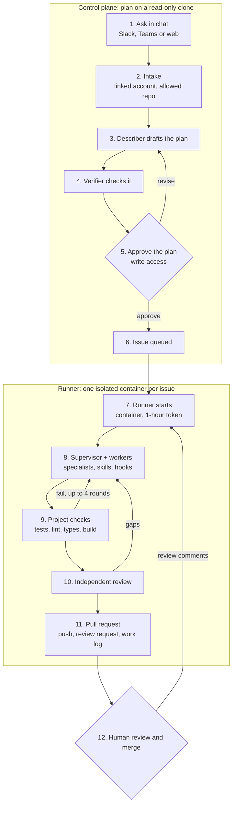
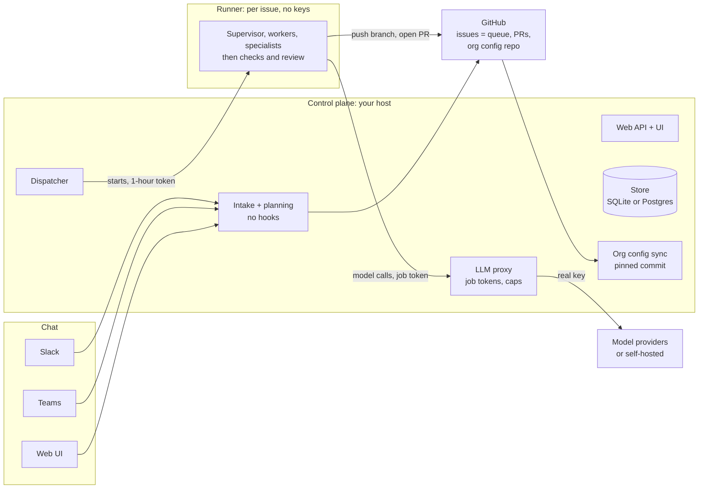

# Pullwright: a proposal for adoption

*An open-source agent harness that turns a task written in chat into a reviewed pull request, run entirely on your own infrastructure.*

> A formatted version of this overview, with drawn diagrams, is in [pullwright-overview.html](pullwright-overview.html).

## Summary

Pullwright turns a task written in Slack, Microsoft Teams or a web page into a reviewed pull request. A person approves every plan before any code is written, and a person reviews every pull request before it merges. In two end-to-end runs on a test repository, a task went from a chat message to a ready pull request for **$0.108 and $0.135** in model spend, with all checks passing on the first round.

We propose a **six-week pilot** on two or three low-risk repositories, run entirely inside the organisation's own infrastructure. Pullwright is open source (Apache-2.0), so the organisation can audit every line, run it on its own machines and choose which model providers it trusts.

**What the pilot needs:**

- a GitHub App installed on the pilot repositories;
- one machine or container host for the control plane;
- a model provider account (or a self-hosted model);
- two or three engineers willing to send it small tasks.

## What it does

| Who | Does what | Can it change code or GitHub? |
|---|---|---|
| Developer | Writes the task in chat, approves or revises the plan, reviews the PR, leaves review comments | Yes: they merge |
| Describer agent | Reads a read-only clone and drafts the plan: files, steps, acceptance criteria, test plan, risks, open questions | No (read-only tools) |
| Verifier agent | Checks the plan against the code and sends corrections back to the describer | No (read-only tools) |
| Supervisor agent | Splits the approved plan into tasks inside the runner and judges each result | Only inside the runner's throwaway clone |
| Worker and specialist agents | Read, edit and run tests for one task each, on a cheaper model | Only inside the runner's throwaway clone |
| Checks | The project's own tests, linters, type checks and build | Decide when the work is done; no model involved |
| Independent reviewer | Compares the result with the acceptance criteria before the PR opens | No |
| Pullwright pipeline | Pushes the branch, opens the PR, posts the work log | Yes, through a GitHub App limited to the installed repositories |

What stays human: approving the plan, merging the pull request, and any review feedback, which sends the runner back to the same branch.

## How a run works end to end

A run has two halves: planning on the control plane, which never changes code, and implementation in a throwaway runner, which never merges.

## System design

Pullwright is two programs the organisation runs itself: a control plane (one process or container) and a runner image started once per issue. GitHub is the queue and the system of record; no other external service is involved.

| Component | Responsibility |
|---|---|
| Channels | Slack (Socket Mode, no public URL), Microsoft Teams (Bot Framework, verified JWTs), web UI (GitHub login). Chat accounts are linked to GitHub logins through a signed link. |
| Intake and planning | Turns a mention into a request, clones the repository read-only, runs the describer and verifier, posts the plan card, waits for a write-access approval, and opens the issue. |
| Store | Requests, threads, every agent event and cost breakdown. SQLite for one machine, Postgres for a shared deployment. |
| Org config sync | Fetches the shared skills, agents and hooks repository, pins the commit, hands that commit to each runner. |
| Dispatcher | Watches GitHub for queued issues and PRs with new review comments, and starts one runner per piece of work. |
| LLM proxy | Holds the provider keys, swaps each runner's job token for the real key, meters usage and refuses calls past the cap. |
| Runner | Clones one repository with a one-hour token, runs the agents until the checks pass, gets an independent review, pushes the branch and opens the PR. |

## Guardrails and data protection

Code and credentials stay inside the organisation's own infrastructure. The only data that leaves is the prompt sent to the model provider the organisation chooses, and that can be a self-hosted model.

| Concern | What Pullwright does |
|---|---|
| Where code goes | Cloned only onto the organisation's control plane (read-only, for planning) and into throwaway runner containers. Nothing is sent to Pullwright's authors; there is no telemetry. |
| What reaches a model provider | The task, the plan, the file contents and command output the agents read. With a self-hosted model, nothing leaves the network. The provider is chosen per role. |
| API keys | With the LLM proxy on, runners never hold a provider key. Each job gets a token that works only through the control plane, is capped in dollars and is revoked when the job ends. |
| GitHub access | A GitHub App installed only on approved repositories. Each runner gets a token for one repository that expires within an hour. The shared-config repository is read with a contents-only token. |
| Who can start work | Anyone linked to a GitHub account can ask for a plan; only people with write access to the repository can approve one. Tasks for repositories outside the configured list are refused. |
| What agents can do | Planning agents have read-only tools. Runner agents work in a non-root container with CPU, memory and process limits, no host mounts and no-new-privileges. Agents cannot push or call `gh`. |
| Dangerous commands | A built-in deny list blocks force pushes, hard resets, recursive deletes of `/` or `~` and disk formatting. Inside a runner, `git push` and `gh` are blocked too. The organisation adds its own patterns, and a repository cannot remove them. |
| Configured commands | Hooks run only inside the isolated runner, never on the control plane. |
| Who steers follow-ups | Only comments from people with write access. Bot and outsider comments are ignored. |
| Secrets in logs | Tokens are stripped from saved git remotes and redacted from errors. Secrets reach containers by environment variable name, never on a command line. |
| Runaway spend | Dollar caps per plan and per issue, a round limit, and the proxy's central cap. |

**What the organisation should still do:**

- run the pilot on repositories with no production secrets in them;
- restrict runner network egress to package mirrors, GitHub and the control plane;
- protect the shared-config repository with required reviews.

## Production-grade practices

| Area | Practice |
|---|---|
| Correctness | The project's tests, linters, type checks and build are the gate. A run that stops red opens a draft PR that says why. |
| Human control | Plan approval by a write-access holder, PR review before merge, and review comments that send the runner back to the same branch, with a work log on every run. |
| Isolation | One throwaway container per issue: non-root, resource limits, no host mounts, removed on exit, 90-minute timeout. |
| Budgets | Per-plan cap (default $1), per-issue cap (default $5), round limit (default 4), enforced in the agent loop and again in the LLM proxy. |
| Cost visibility | Tokens and dollars on every call. Cost per stage and model on every PR. A web Costs view per stage, model, repository, requester and day. |
| Observability | Every agent turn, tool call, check result and state change is an event. Each request has a live timeline and runner panel. |
| Testing | 134 automated tests with a scripted model and a fake GitHub. CI runs them on every push, including against Postgres, and builds the web UI and both container images. |
| Evals | Planning evals (do plans name the right files; does the verifier catch planted mistakes) and implementation evals (pass rate and cost per task). |
| Deployment | One container for the control plane (Docker Compose included) with a healthcheck; SQLite or Postgres; amd64 and arm64 images on tagged releases. |
| Change control | Shared agents, skills and hooks live in a reviewed repository pinned to a tag. Each task runs against the exact commit the control plane resolved. |

## Using the organisation's shared skills, agents and hooks

One setting, `PULLWRIGHT_ORG_CONFIG=<owner>/<repo>@<tag>`, points Pullwright at the shared repository. A repository already laid out for Claude Code (`.claude/agents`, `.claude/skills`, hooks in `.claude/settings.json`, `CLAUDE.md`) works without changes.

| In the shared repository | What it does in Pullwright |
|---|---|
| An agent named after a Pullwright role | Replaces that role's prompt, tools or model for every repository |
| Any other agent (a security reviewer, a migration writer) | Becomes a specialist the supervisor can hand a task to, within the same budget |
| Skills | Available to every agent, loaded on demand |
| Hooks | Run around every tool call inside the runner; exit code 2 blocks the call |
| `CLAUDE.md` or `instructions.md` | Added to every agent's prompt |
| Guardrails | Combined with each repository's lists; a repository cannot remove an organisation entry |

Order of precedence: built-in defaults, then the organisation, then the repository's own `.pullwright/` folder. Protective rules (deny lists and hooks) are combined rather than overridden.

**How it stays consistent and safe:**

- The control plane reads the shared repository with a contents-only token and records the commit; each runner uses exactly that commit.
- If the repository can't be read at startup, Pullwright refuses to start, so it never runs without the organisation's rules.
- The repository can be on any GitHub account; a read-only token covers the case where the App isn't installed there.

## Models and providers

Every role can run on a different provider. The defaults are Claude Sonnet 5.5 for planning, supervision and review, and Claude Haiku 5.5 for workers.

- **Built in:** Anthropic, OpenAI, Google Gemini, OpenRouter, Groq, DeepSeek, Mistral, xAI, Together and Ollama.
- **Self-hosted:** any OpenAI-compatible server (vLLM, Ollama, an internal gateway), with its own prices for cost reporting.
- **Choosing:** one setting per role for the organisation, or per repository.
- **Verified live so far:** Claude models end to end, and a local Ollama model through the LLM proxy with tool calls.

## Cost

A small, well-scoped task has cost about ten to fourteen cents end to end, and most of that was planning.

| Run (2026-11-11) | Planning | Implementation | Total | Result |
|---|---|---|---|---|
| Add `OrderStore.remove` and a half-up percentage discount, with tests | $0.088 | $0.047 | $0.135 | PR ready, checks green in round 1, 72 s runner time |
| Sort `OrderStore.list()` by total (from the web UI) | $0.067 | $0.041 | $0.108 | PR ready, checks green in round 1 |

In the planning evals, a single describer pass cost $0.023 to $0.025 and a verifier pass $0.013. Larger tasks cost more. The caps stop any one task at $1 of planning and $5 of implementation by default.

## Pilot plan

| Phase | When | What happens | Gate to the next phase |
|---|---|---|---|
| 1. Set up | Week 1 | GitHub App on 2-3 repositories, control plane deployed, providers approved, shared config pinned | A sandbox task goes green end to end |
| 2. Supervised use | Weeks 2-3 | 2-3 engineers send small, testable tasks; every PR reviewed | 10 or more PRs reviewed, no guardrail breach |
| 3. Measure and tune | Weeks 4-5 | Track merge rate and cost; tune shared agents and skills; run the evals | Metrics collected for the readout |
| 4. Decide | Week 6 | Readout to engineering leads: expand, adjust or stop | |

| Metric | How it is measured | Proposed target (to agree) |
|---|---|---|
| PRs merged with at most minor changes | PR outcomes on the pilot repositories | Half or more |
| Cost per merged PR | The Costs view and the PR cost tables | Agreed per repository before week 2 |
| Time from task to ready PR | Request and PR timestamps | Faster than the team's usual time for the same task size |
| Guardrail incidents | Blocked commands, hook results, runner logs | Zero data leaving approved providers |

## Risks, limits and open questions

| Risk or limit | Mitigation |
|---|---|
| Agents produce plausible but wrong code | Checks gate every PR, an independent reviewer compares the result with the acceptance criteria, and a person reviews before merge. Pilot repositories need decent tests. |
| Code is sent to an external model provider | Choose an approved provider per role, or a self-hosted model. Pilot on repositories without sensitive code. |
| A malicious repository change tries to steer the agents | Planning is read-only. Only write-access holders approve or steer. Agents cannot push. Hooks run only in the runner. |
| The control plane host is a high-value target | It holds the GitHub App key and the provider keys. Run it on a dedicated, patched host. |
| Live verification is incomplete | Verified live: GitHub App, web UI, Docker runner, LLM proxy, Claude and Ollama models. Not yet: Slack and Teams, other hosted providers. |
| Single-machine scale | One issue at a time by default (configurable). An EC2 runner backend is on the roadmap. |

**Open questions for the organisation:**

- [ ] Which model providers are approved for source code?
- [ ] Which two or three repositories suit a pilot (good tests, no production secrets)?
- [ ] Where will the control plane run, and who operates it?
- [ ] Which chat tool first: Slack, Teams or the web UI?
- [ ] Is the shared skills, agents and hooks repository ready, and which tag should Pullwright use?

---

Source code, documentation and setup guides: https://github.com/Mystery01092000/pullwright
